  

Hi, I'm Yash. I build systems that turn chaos into answers. Sensor streams, event firehoses and the occasional spreadsheet named `final_v7_REAL.xlsx` go in; data people can actually trust comes out. I've moved petabytes without losing a row, and once rewrote a pipeline in Rust just to see how fast "fast" could get (almost 4× faster, it turns out). My favourite systems are the ones nobody ever talks about, because nothing in them ever breaks.

I write in more languages than I can count on my fingers, and I'm always learning the next one. The blueprint is never finished.

**Portfolio:** [yashaggarwal85d.github.io](https://yashaggarwal85d.github.io/yashaggarwal85d/)

[LinkedIn](https://www.linkedin.com/in/yashaggarwal85d/) · [Email](mailto:yashaggarwal85d@gmail.com)
